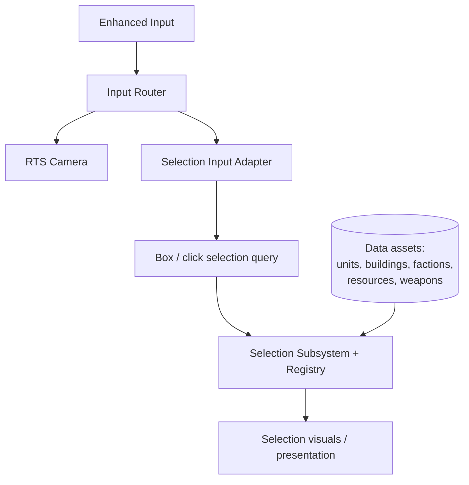

# FrontHits — Real-Time Strategy Game (Unreal Engine 5, C++)

> This repository provides a public overview of a privately maintained software project. The source code is not publicly available.

An original base-building real-time strategy (RTS) game for Windows PC, built with Unreal Engine 5 using a **C++-first** architecture. Current focus: the core RTS control layer — camera, input routing and unit selection.

---

## Project Overview

| | |
|---|---|
| **Type** | Game development (C++ / Unreal Engine 5) |
| **Period** | October 2026 – present |
| **Team** | Solo project |
| **Platform** | Windows PC |

## Problem & Solution

**Goal:** Build a solid, testable RTS foundation before adding content. RTS games live or die by responsive controls with hundreds of units on screen.

**Approach:** Gameplay systems are written in C++ as Unreal subsystems with clear responsibilities, data is defined in data assets, and every milestone is verified with automated tests and measured performance budgets.

## Key Features (implemented)

- **RTS camera:** pan, zoom, edge scrolling, map bounds
- **Input routing** layer on top of Enhanced Input
- **Unit selection:** click, box selection, Ctrl / Shift modifiers, selection rings, double-click "select all of type"
- **Data-driven definitions** for units, buildings, factions, resources and weapons with typed identifiers
- Development sandbox map with a debug panel and editor automation scripts

**Designed, not yet implemented:** control groups.

## Technology Stack

| Area | Technologies |
|---|---|
| Engine | Unreal Engine 5 |
| Gameplay code | C++ (single runtime module), Blueprints only where needed |
| Engine modules | Enhanced Input, Slate / SlateCore, RenderCore, RHI, Asset Registry |
| Tooling | Python editor scripts (sandbox generation, test actor placement) |
| Testing | Unreal Automation tests (native C++) |

## System Architecture

Source is organised into `Camera`, `Input`, `Selection`, `Data`, `Identifiers` and `Development` folders.

## My Role & Contributions

Sole developer:

- Game architecture and C++ systems design
- Camera, input routing and selection systems
- Data model for gameplay definitions
- Automated test suite (77 passing automation tests at the selection milestone)
- Performance measurement and QA matrices
- Architecture decision records (ADRs) and milestone documentation

## Development Process

- Milestone-based development with architecture docs, ADRs, QA matrices and a known-issues / tech-debt register
- AI-assisted workflow with separate roles for planning, implementation and testing; each step documented as a numbered task
- Feature branches per task

See [DEVELOPMENT_LOG.md](DEVELOPMENT_LOG.md).

## Project Status

**In active development.** Camera and selection milestones are complete; control groups are the next milestone.

## Screenshots

Not available yet — the project is currently in a technical sandbox stage without final art.

## Technical Challenges & Solutions

| Challenge | Solution |
|---|---|
| Selecting many units without frame drops | Dedicated selection subsystem and registry, verified with performance measurements (~70 FPS with 500 selected units, standalone build) |
| Conflicting input between camera and selection | Central input router that dispatches to systems |
| Regressions in core controls | Native automation tests per system |
| Reproducible test scenarios | Python editor scripts that generate the sandbox level and test actors |

## Skills Demonstrated

`C++` `Unreal Engine 5` `Game architecture` `Unreal subsystems` `Enhanced Input` `Automated testing` `Performance profiling` `Python tooling` `Architecture decision records` `Technical documentation`

---

### About the source code

The original repository is private. This showcase contains documentation only.
